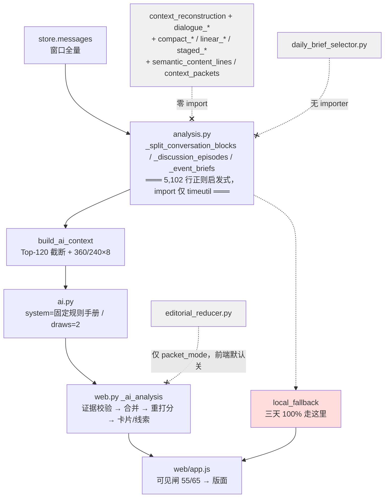

# 微信日报算法 · 勘察报告（主报告）

> 日期：2026-09-22
> 范围：`D:\Zcode\WeChat_CatchCatch` 全项目，聚焦「微信日报的信息处理算法为何长期效果不理想」
> 性质：**只读勘察**。本轮未修改任何生产代码、配置或数据。
> 配套：证据明细见 [daily-brief-reconnaissance-evidence-2026-09-22.md](daily-brief-reconnaissance-evidence-2026-09-22.md)
> 隐私：本文不含聊天原文、真实姓名、wxid、手机号。涉及具体人名处以「特定联系人」「群 B」等抽象指代，需要定位时回查 `docs/daily-brief-annotation-codebook-v2.md` §3.1。

---

## 1. 一句话结论

> **用来评价日报的那条链，和迭代了一年的那条链，是两套完全不相干的代码。**

`src/wechat_bridge/analysis.py` 的 import 只有 `timeutil` 与标准库。生产日报的切分、聚类、事件候选全部由 `analysis.py` 内部一套独立实现承担。
而 `context_reconstruction` / `dialogue_segments` / `dialogue_bundle` / `bundle_semantics` / `discourse_event_candidates` / `semantic_content_lines` / `context_packets` / `compact_*` / `linear_*` / `staged_*` / `cross_date_experiment` / `stage1_*` —— **生产代码一处不 import**。

旁链同样如此：

- `daily_brief_selector.py`：**全仓库无 importer**，产物不进日报；
- `editorial_reducer.py`：仅在 `packet_mode` 下启用（`web.py:4398`），而 `web/app.js:1449` 默认不开 packet_mode；
- `staged_deepseek_analyzer.py`：仅研究 runner 引用；
- `/api/shadow-analysis`：`web.py` 注释自述 "The homepage never calls this endpoint"。

$$\underbrace{95{,}249 \text{ 行研究脚手架}}_{81.6\% \text{ 的源码}} \quad\cap\quad \underbrace{\text{日报生产链}}_{\texttt{analysis.py + web.py + ai.py + app.js}} \;=\; \varnothing$$

改 prompt、改体裁、改标题、跑 oracle、建金标 —— 全在研究侧；用户读到的日报，在生产侧。**这是「一直不理想」的机械原因，与算法优劣无关。**

---

## 2. 核心事实：用户实际读到的是 `local_fallback`

`data/private/daily_brief_research/freeze_manifest.private.json` 的 `run_metadata`（2026-09-18 阶段 A 冻结）：

| | 2026-09-07 | 2026-09-08 | 2026-09-16 |
|---|---|---|---|
| `llm_accepted` | `false` | `false` | `false` |
| `fallback_reason` | `local_fallback` | `local_fallback` | `local_fallback` |
| `editorial_reducer_accepted_headline_count` | — | **0** | **0** |
| `review_sample_audit_passed` | `false` | — | `false` |

**三天 100% 走 `local_fallback`。** 语义管线在用户可见的产出上从未成功过一次。

注意 `accepted_headline_count` 的性质：它是**纯计数器**（`web.py:5472-5503`），**代码中不存在依据它改变行为的分支**。它被计算、被写进冻结清单，但没有任何代码听它。

### 2.1 真实日报链



### 2.2 O-G 消融：瓶颈在选择，不在成稿

2026-09-16 的 Generation Oracle 固定 B0 选择结果、**不增不删**，仅由人工忠实改写。按 `docs/daily-brief-oracle-experiment-v1.md` §6，这一步用于分离「选择错」与「成稿错」。

| 指标 | B0（现状） | O-G（人工忠实改写） | Δ |
|---|---|---|---|
| `acu_precision` | 0.250 | 0.250 | **0.0** |
| `acu_recall` | 0.135 | 0.135 | **0.0** |
| `must_recall` | 0.143（4/28） | 0.143 | **0.0** |
| `unsupported_claim_rate` | **0.712**（42/59） | 0.712 | **0.0** |
| `redundancy_rate` | 0.167 | 0.167 | **0.0** |
| `slot_accuracy` actor | 0.118 | 1.000 | +0.88 |
| `slot_accuracy` object_or_recipient | **0.000** | 1.000 | +1.00 |

**内容类指标 Δ = 0.0 ⇒ H1b 成立：瓶颈在选择，不在成稿。**
人物归因槽位人工一改即从 0.12 → 1.00，说明**归因是可修的成稿问题；内容选错，成稿层救不回来**。

> 口径警告：上表 `must_recall` 是 round1 口径（28 must）。最新仲裁版为 14 must（独立复核后约 8 must / 3 story）。**先统一尺子再比较版本**，否则会重演「改完不知道好没好」。见附录 §F。

### 2.3 量化定义：什么叫「不理想」

`data/private/daily_brief_research/2026-09-16/value_gate_audit.private.json` 独立复核后认定这一天**正确的日报是 3 条公开主线故事 + 1 条私密备忘**：

| story | 构成 |
|---|---|
| AI 可靠性 / 额度与替代方案 | 3 条 ACU 合并为一条，保留各自边界 |
| 活动道具指派 | 1 条（明确 @ 用户、完成状态无直接证据） |
| 团组织关系转接交接 | 3 条（中性联合主体 + 材料缺口 + 近端时间压力） |
| *（私密备忘）* | 本人设备维修状态 |

而 B0 实际输出 **59 条主张，其中 42 条无证据**。

$$\text{正确 } 3 \text{ story} \quad\text{vs}\quad \text{B2 选出 } 78 \text{ 条} \quad\text{vs}\quad \text{B0 输出 } 59 \text{ 条（42 条无证据）}$$

### 2.4 同输入（2026-09-16）四方法对照

| 方法 | 输出量 | 与正确答案的差距 | 备注 |
|---|---|---|---|
| B0（当前生产路径） | 59 条主张 → 6 findings + 15 线索 | `must_recall` 0.143、`unsupported` 0.712 | `local_fallback` |
| query-selection（B2 试跑） | **78 / 411** 选中 | 超选 ~26×，含琐碎项 | policy 干净（无 top-k / 无 fallback），但**无收口判据** |
| 无模型重建 | 402 卡 | — | 无选择、无标题，纯原料 |
| semantic 版 | 392/402 抽取成功 | 约 1/3 候选槽位退化为「场景＋确认/询问」分类式假标题 | 10 卡失败 |

---

## 3. 七个根因

### ① 诊断对象 ≠ 线上产物（最高层）

见 §1。整条复杂重建链与产品零耦合，`dialogue_segments.py` 的 docstring 甚至明写 *"The production analysis path intentionally does not import this module."*

数字链「3,925 → 417 → 76 → 402 → 392」出自 `semantic_content_line_runner.py`（入口 `require_development=True`、需显式 `--allow-provider-data-transfer`），**不是日报产出**。且其中「76 交流流 → 402 交流卡」与实现对不上：flows 由 episodes 经 union-find 合并而来，cards 由 threads 生成，是**两条并行分支**，`402 > 76` 是扩张而非压缩。

### ② 主线丢失发生在候选化阶段，成稿设计上不回溯

`analysis.py:3972-4135 build_ai_context`：`窗口全量 → 过滤 → Top-120（API 上限 200）→ content ≤360 字 / context ≤8×240 字`。
成稿层拿到的就是这个截断样本；恢复通道（`web.py:4933-5240`）的证据**仅限候选集**，不回溯原始消息。

⇒ **恢复必须在候选化阶段做**（分层保底入样），改成稿 prompt 无效。

### ③ 选择判据把日报推向琐碎与私密

```python
# analysis.py:3026-3033  —— for_me 的全部判据
for_me = has_private OR mentions_me OR action_for_me OR has_self OR matched_profile
```

五项取 OR，`has_private` 单独充分 ⇒ **任何私聊消息无条件进 `for_me` 车道**。
配套加分（`web.py:3577-3580` card / `web.py:3623-3626` lead）：**私聊在 lead 车道独占 +30，card 车道 +12**。

`matched_profile` 是纯子串匹配 `term in combined_content`（`analysis.py:3032`）—— 画像里写「工作」，任何含「工作」二字的消息都进 `for_me`。

另有硬编码领域特权（`web.py:5083, 5096`）：

```python
priority_domains = {"wechat", "gpt_service", "codex_service", "developer_account"}
minimum_priority = 45 if domain_tags.intersection(priority_domains) else 65
```

**20 分门槛特权** ⇒ 日报里 GPT/Codex/AI 内容的膨胀程度即此行硬编码。EL-011/012/013 三天重复的同一 AI 主线不是巧合。

⇒ 这是 EL-008/E6（私密参会/维保状态进正文）与 EL-014/E9（隐私进入可转发版式）的直接机制。CHANGELOG 里「修复私聊被统一标低重要性」是**反向过矫正**。

### ④ 模板化来自模型之后的本地回填层，改 prompt 无效

三处同构罐头标题库 + 固定后缀：

| 位置 | 内容 |
|---|---|
| `web.py:163-309` | 罐头标题库 |
| `analysis.py:198-316`（`normalize_editorial_title:261`） | 标题模板 + 固定后缀；`fallback = "讨论主线：内容开始成形"`（`:315`） |
| `web/app.js:1059-1074` | 前端模板标题 |
| `analysis.py:4991-5011` | 基线导语模板 |
| `web.py:4221-4279` | 占位句 |

「罗列体」的直接来源是 `_merge_draw_findings`（`web.py:3901`）把多条 claim **分号拼接**为 `narrative`，不是模型文风问题。

### ⑤ fallback 伪装成功

三天 100% `local_fallback`（§2）。检测已修（`llm_accepted` 被诚实记录），**行为未修**（仍产出 fallback 日报给用户）。`freeze_manifest.top_bottlenecks[3].next_experiment` 已明确写着「禁止回退冒充正式结果」——它在待办里，不在已完成里。

### ⑥ 尺子不稳且口径不一

- 独立 value gate 复核 14 条 `must`：**9 条应降级、4 条漏标**；
- 两把尺子并存：round1（148 ACU / 28 must）vs 仲裁版（1,102 ACU / 14 must）；
- 金标是**条件性的**：只覆盖 411 个 content-line candidate / 1,442 个证据 ID，不是 3,925 条全量 ⇒ **上游未进候选的消息永远不会成为 `must`，E5/H1a 原理上测不出来**；
- `slot_accuracy` 是词面精确匹配，O-G 复制金标槽位即得 1.0，测不出语义正确性；
- 标注独立性双层不足：08-25 是两个正则脚本互标 + 脚本仲裁；09-16 是同一人不同时间双轮（codebook v1 明文许可）。round1 148 vs round2 1,124 精确证据交集仅对上 **10 条**，1,102 行中 **18.7%** 标签被仲裁改写；
- roadmap §8 的 9 项指标中 **3 项未实现**（weighted ACU coverage、关系方向错误率、unknown 强行确定率）；bootstrap 置信区间与逐日配对比较**零实现**；`split_validator.py` 只有 `development|frozen_test` 两段，无校准/盲测三段；oracle 5 条件只跑了 **B0 与 O-G**。

> 附注：评测脚本本身是可信的（确定性、拒绝合成总分、fail-closed），76 个测试函数中约 69 个真守行为契约。**工具没问题，是刻度和覆盖有问题。**

### ⑦ 零版本记录 ⇒ 消融物理上不可能

```
08-24  chore: publish wei daily 0.1.4     ← 全部代码一次性灌入（含 95k 行研究脚手架）
  ↓  约 18 个 docs / rebrand / chore 提交
09-04  feat: strengthen semantic contracts
09-17  feat: WeChat capture tool and editorial pipeline upgrades
09-17  merge 8b4a94d                       ← GitHub 到此为止
  ↓  【空白】
最近 3-4 天   daily_brief_selector + tools + tests + docs   ← 未提交
```

| 阶段 | 工作量 | 版本记录 |
|---|---|---|
| K1-K31 / P0-P0.1.4 / contextual-bundle v1-v2.11 | ~95,000 行 | 无（随 `chore: publish` 灌入） |
| 日报选择器工作线 | `daily_brief_selector.py` 35.6 KB + tools + tests + docs | 无（未提交） |

**有版本记录的算法迭代 ≈ 0。** roadmap §10 第 4 条「消融实验能把改善归因到该改动」缺自变量，物理上无法执行。

---

## 4. 行动清单

### 🔴 今天就做（≤2 小时，零风险，纯保命）

| # | 动作 | 理由 |
|---|---|---|
| 1 | **备份 `data/private/daily_brief_research/`** 到 `data/` 之外 | ACU 金标（1,102 行人工仲裁）、`error_ledger`、oracle runs、`freeze_manifest` 全部位于 `.gitignore:13:data/`，git 保护不到。是 18 个月里唯一一份人工标注资产 |
| 2 | **commit 当前工作线** | `daily_brief_selector.py` + `tools/` + `tests/test_daily_brief_*` + `docs/daily-brief-*` 全部未提交。不必推，但必须有提交边界 |
| 3 | **`api_key` 移出 `data/workbench_settings.json`** | 现为明文落盘。转 Windows Credential Manager 或环境变量 |
| 4 | `git worktree prune` | `.git/worktrees/recover_worktree` 指向已删除路径 |

### 🟠 本周（1–2 天，改的是用户实际看到的东西）

| # | 动作 | 判据 / 位置 |
|---|---|---|
| 5 | **删三处罐头标题库 + 固定后缀**，宁可显示「未生成合格标题」 | `web.py:163-309`、`analysis.py:198-316`、`app.js:1059-1074`。这是「分类式假标题」的唯一来源 |
| 6 | **fallback 显式化**：0 合格 → 「本期无合格日报 + 失败原因」；把 `accepted_headline_count` 从纯计数改成**行为开关** | `web.py:5472-5503` |
| 7 | **候选化阶段分层保底入样** | `build_ai_context` 在 Top-120 之前按 story/会话各保底 1 条 |
| 8 | **削弱私聊特权** | `has_private` 不再单独充分（须叠加 action/object/status）；lead `+30` 降到与 card 一致；统一私聊下限（prompt 60 / 代码 55 / `∈{55,62}` 覆盖三处收敛到一个语义） |
| 9 | **移除 `priority_domains` 45/65 特权** | `web.py:5083, 5096` |
| 10 | **story 级去重** | 现有 refs⊆ 即删（`web.py:3159`）与 50% 重叠合并（`web.py:3901`）覆盖不到 E8（同一标题重复 4/4/3 次） |
| 11 | `ai.py:539` 真实人名示例移出 system 前缀 | 隐私 + 死内容 + 过拟合源 |
| 12 | `reasoning_content` 回收文本**过 schema 校验** | `ai.py:610-661` 现为无校验放行 |

### 🟡 下一阶段（先定方向，再写代码）

| # | 动作 | 目的 |
|---|---|---|
| 13 | **跑 B1 对照**：扁平消息 + query 检索，替换复杂重建 | 复杂重建「不可替代的类型化关系边 + 说话人分离」恰是出错最多的部分（E2/E3/E4），且从未进生产、无 H3 提升证据。按 roadmap §10「复杂方法没显著胜过 B1 就选简单方法」→ **应选 B1**。真正值得保留的只有 message ledger + reply/@/speaker 扁平元数据 |
| 14 | **跑 O-S**（Selection Oracle） | O-G 只证明「成稿救不了选择」，未证明「给对内容成稿就够好」。O-S 是 H1b/H1c 的那一刀 |
| 15 | **金标扩到 5–7 天** + 补 09-08 标注 + 修 09-07/09-16 输入快照 | 现为 1 天 / 18 个月；09-08 完全无金标却有 29 个分支产物；09-07 无原始快照、09-16 的 `.db` 不可读 ⇒ 不可重放 |
| 16 | **上游召回无偏探针** | 每天从原始消息随机抽 200 条独立标注，与候选集做差集。金标现为条件性，E5/H1a 测不出来 |
| 17 | **B2 收口规则**取自 `value_gate_audit.not_promoted_reason_counts` | 4 类淘汰判据 + 429 条 may 当负例回归。78 条应收至 3–8 story |
| 18 | **反馈闭环提前** | `human_labels` 现为空。四个按钮（有用 / 琐碎 / 错误合并 / 漏了重要）→ `review_actions`。**它是 B2 的前置依赖**，不只是产品项 |
| 19 | **外在效用指标** | 给定日报，30 秒内能否答出「今天要做的 3 件事 / 哪些有截止时间 / 哪些等我确认」。这是 `docs/product-feedback-checklist.md` P1 第一条，也是「日报效果不理想」的真实定义 |

---

## 5. 明确该停的四件事

| 停 | 理由 |
|---|---|
| **`contextual_bundle_*` / `compact_*` / `linear_*` / `staged_*` 全线** | 整条 `production_blocked`；851 次模型调用成功 8 次；v2.10/v2.11 有效语义编码 **0**。根因是 2,000 input / 400 output 预算与 215 条大包不匹配 —— 缺的是 provider 的 strict JSON / tool-call 能力，不是再调协议 |
| **继续改 prompt 文风** | 病灶在模型**之前**（`build_ai_context` 截断）与**之后**（罐头库回填）各作用一次，模型夹在中间 |
| **继续加报纸壳装饰** | 6 张版面截图中唯一有真实内容的，恰好是唯一没走完整管线的那张；`final` 版比早期**装饰更重而内容为空** |
| **在 `daily_brief_selector.py` 上继续做研究** | 无 importer、产物不进日报。要就接进生产（替换 `for_me` 判据），要就归档 |

---

## 6. 目标重新对齐（产品侧未完成项）

`docs/product-feedback-checklist.md` 中 P1 真实价值项几乎全部未勾：

- [ ] **每条整理结果都要回答「看完之后怎么办」：状态、待确认问题、责任人、截止时间或下一步**
- [ ] 以「事项/事件」而不是「消息条数」作为主要整理单位
- [ ] 将多个会话中关于同一件事的消息合并成一条事件主线
- [ ] 建立用户反馈闭环
- [ ] 提升群聊发言人识别和名称消歧
- [ ] 让「噪声过滤」可配置

与之对应，近期迭代集中在体裁分层、判断式标题、禁罗列体、媒体套话黑名单 —— **优化目标与价值项错位**。
另注：`analysis.py` 的 `importance = avg_score + min(10, msg//20) + min(8, chat*2) + 6*resource` 按**消息量与会话数**加权，必然使刷屏群顶掉「单条但关键的私聊决定」，正对应上表第二条。

roadmap §13 引用了 Pu, Gao & Wan (2024)《Is Summary Useful or Not? An Extrinsic Human Evaluation of Text Summaries on Downstream Tasks》，但未把「有用」落成任何指标。行动清单 #19 即此。

---

## 7. 遗留不确定性

- **[INFERENCE]** 模板标题在实际产出中的占比分布 —— 需脱敏统计脚本验证，本轮未做。
- `output/briefing_2026-09-16.db` 不可读（多种方式失败），09-16 原始输入快照缺失，重放性存疑。
- 选择层的完整阈值盘点（约 40 项）由勘察方补全，其中一路子智能体被 provider `content-filter` 中断，**可能仍有遗漏**。
- O-G / B0 的 `must_recall` 等指标基于 round1 金标；换成仲裁版后数字会变。**先统一尺子再比较版本。**
- 两棵树**无语义分叉**（76 个共同模块逐字等价，差异仅 CRLF/LF），但 `D:\Project_Codex\Project_WeChatMoreFunction` 的 `wechat_bridge.db-wal` 3.9 MB 仍活跃 —— **不可当开发树修改**。
- 本轮为静态代码与产物证据；未运行评测、未改动生产代码。

---

## 8. 勘察方法与可信度

本次勘察由 **7 路并行深审 + 主勘察方逐行复核** 构成，每条结论均可回溯到具体文件行号或数据产物：

| 切片 | 覆盖 | 状态 |
|---|---|---|
| 迭代史考古与方法论诊断 | `docs/**`、`tests/audit_*`、git log/reflog | 完成 |
| 下游成稿链路 | `web.py` `_ai_analysis`、`ai.py`、`editorial_reducer.py`、`app.js` | 完成 |
| 上游重建与切分链路 | `context_*`、`dialogue_*`、`compact_*`、`linear_*`、`semantic_*` | 完成 |
| 内容选择 / 分层 / 评分门槛 | `selection_strata`、`semantic_gate`、`analysis.py` 选择逻辑 | **部分**（子智能体被 `content-filter` 中断，缺口由主勘察方补全） |
| 评测与金标基础设施 | `tools/daily_brief_*`、`annotation_tools`、`data/qa/**` | 完成 |
| 真实数据与产出实况 | `data/**`、`output/**`、`artifact/**`、版面截图 | 完成 |
| 多副本 / 工作区关系 | 两棵树 + 发布链 + 推广工作区 | 完成 |

**收敛性证据**：`freeze_manifest.top_bottlenecks`（勘察开始前已存在，由项目自产）与本轮独立的 O-G 消融分析得出**同一排序** —— 第一位均为「全局内容选择与重复压缩」，第二位均为「交流边界、对象和关系归因」。两条独立路径收敛，可信度高于单一来源。

---

## 9. 建议的阅读顺序

1. 本文 §1–§3 —— 先理解「为什么一直不理想」；
2. 行动清单 §4 的 🔴 四项 —— 先保住资产；
3. 附录 §C 阈值总表 + §D 错误映射 —— 动手前定位；
4. `docs/daily-brief-research-roadmap-v2.md` §4–§7 —— 研究设计仍然成立，只是执行对象一直是错的那条链；
5. `docs/daily-brief-oracle-experiment-v1.md` §6 —— O-S 仍是待跑的那一刀。

---

**收口**：工程严谨度不是问题 —— 错误账本、ACU 标注规范、oracle 协议、freeze_manifest 的质量超过多数正式研究项目。问题只有一个：**那 95,000 行的严谨，与用户每天读的那份日报之间，没有一条 `import`。**
